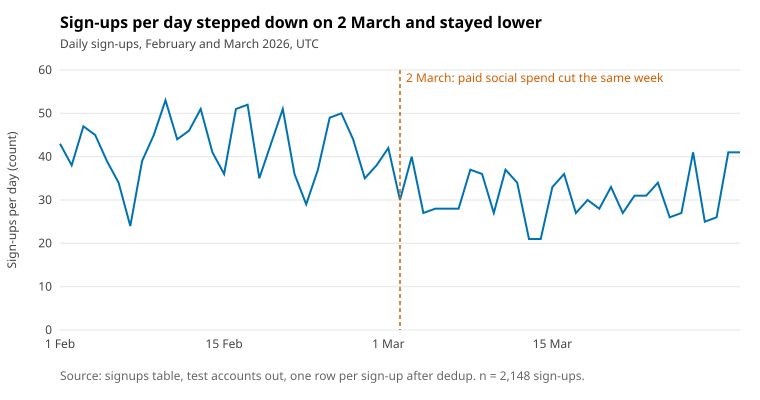

format: v1

# Readout: sign-ups in March 2026

**Status: FINAL**

Audience: exec
Date: 2026-04-08

## 1. Answer

> **Answer:** Sign-ups fell from 1,175 in February to 973 in March, down 17%. Per day the fall was 25%, because March is three days longer. Almost all of the fall is in one channel, paid social. This analysis shows where the fall is. It does not show why.

## 2. Key numbers

| number | value | uncertainty |
|---|---|---|
| Sign-ups, February | 1,175 | exact count for the month. 0.3% above the growth dashboard (1,171) |
| Sign-ups, March | 973 | exact count for the month. 0.1% above the growth dashboard (972) |
| Change in sign-ups per day | 42.0 to 31.4, down 25% | exact for the two months |
| Paid social sign-ups per day | 15.3 to 5.4, down 65% | exact for the two months. Depends on how sign-ups are attributed to channels (see caveats) |
| Paid social share of the total fall | 94% | same |

## 3. Charts

The chart replaces the weekly numbers: the fall arrived as a step in the week of 2 March, not as a slow slide.

## 4. What it means

The fall is not spread across the business. **It sits in paid social, and it arrived as a step in the first week of March.**

Paid social spend also fell in the same week, from about 2,800 a week to about 980. That timing is a lead worth following, not a proven cause.

> **Ask:** decide whether to run a spend test before the Q2 channel split: restore spend in some markets and hold it in others. That is the clean way to learn whether spend explains the fall.

## 5. Caveats

> **Caveat:** the channel on each sign-up comes from an attribution rule we could not check (assumption A4). If that rule changed in March, sign-ups may have moved between channels on paper. The total fall of 17% does not depend on it.

- What this analysis can and cannot say: it describes what happened in February and March. The channel pattern is something we see and that is worth testing. It does not show that the spend cut, or anything else, caused the fall.
- We have no data for March last year, so we cannot compare with the usual season. The other channels did not fall, so the data does not show a dip across the board.

## 6. Method

Data: the `signups` table for January to March 2026, test accounts excluded, one row per sign-up after removing 40 late-update duplicates, UTC.
Method: counts per day and per full week, then a scan of four dimensions listed in advance (channel, platform, country, plan), with a second cut to confirm.
Checks passed: daily series with no gaps or zero days; rungs 1 to 3 on raw rows (rung 3 failed on duplicates, then passed after the fix); rung 4 summed the cleaned table and the review recomputed the headline numbers from the raw table, with no gap; totals reconcile to the growth dashboard within 0.4%.

## 7. Link

Working notes: `analysis.md` (its Review pack holds the code behind each headline number).

## 8. Appendix

| number | value | uncertainty |
|---|---|---|
| Other four channels combined, per day | 26.6 to 26.0, down 3% | exact for the two months |
| Week the fall began | week starting 2 March: 218 sign-ups, after 295 the week before | full weeks, Monday to Sunday |
| Platform, country and plan | no new pattern: mobile fell most only because paid social is mostly mobile | exploratory scan of 4 dimensions, 12 segments |
